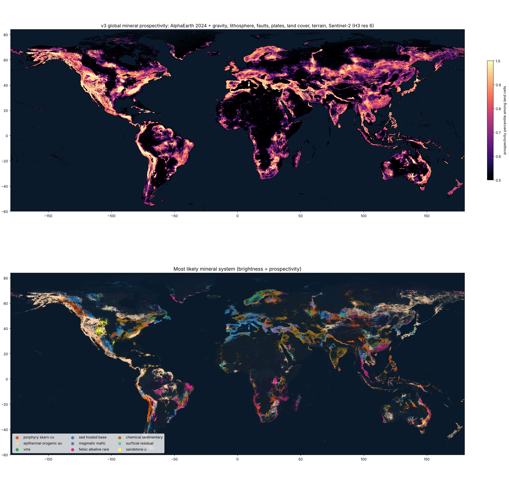

# earthprosp

**Mineral prospectivity for every land cell on Earth**, from AlphaEarth Foundations (AEF)
satellite embeddings plus public geophysics, lithosphere, tectonics, seismicity and terrain
data. Each of **4,489,547** H3 res-6 cells (~36 km²) gets a calibrated deposit probability,
a split across 15 commodities and 9 mineral systems, a dedicated score per mineral system,
bag-disagreement uncertainty and an area-of-applicability flag.

* **Interactive explorer (claude.ai artifact, private to the project owner unless shared):** https://claude.ai/artifact/GgtPA8Q2R5aRkM5qYGm61J
* **Current map (v3, lean and town-neutralised):** `outputs/v3L/` (explorer.html, v3_map.png,
  by_country.csv, greenfield_candidates.csv, global_v3_res4.parquet)
* **Query a point or an area:** `python -m earthprosp.query point -22.3 -68.9`, `python -m earthprosp.query area --bbox -70 -25 -67 -20 --system porphyry_skarn_cu --greenfield`
* **What v3 changed, validation and results:** [docs/V3.md](docs/V3.md)
* **Every dataset, where it came from and its licence:** [docs/DATA_SOURCES.md](docs/DATA_SOURCES.md)
* v2 (AEF only) design notes: [docs/DESIGN.md](docs/DESIGN.md)



## Headline numbers (v3)

Capture AUC (0.5 = random, 1 = every deposit ranked first). CV uses spatial blocks with a
50 km dead zone; a hold-out hides a whole continent from training.

| test | distance to known deposits | v2 (AEF only) | **v3** |
|---|---|---|---|
| Spatial CV, all deposits | 0.71 | — | **0.89** |
| South America hidden, all deposits | 0.54 | — | **0.77** |
| Spatial CV, world-class deposits | 0.64 | 0.81 | **0.84** |
| Africa hidden, world-class | 0.43 | 0.79 | **0.86** |
| Australia hidden, world-class | 0.44 | 0.77 | **0.84** |
| South America hidden, world-class | 0.54 | 0.69 | **0.76** |
| Spatial CV, porphyry Cu (dedicated head) | — | — | **0.91** |
| South America hidden, porphyry Cu (dedicated head) | — | — | **0.92** |

The shipped model is lean: AlphaEarth plus lithosphere (LITHO1.0, CRUST1.0, heat flow) and
surface layers (land cover, terrain, Sentinel-2). Gravity, magnetics and the tectonic layers
help inside the training continents but hurt a hidden continent, so they are left out of
the map and kept in the pipeline (docs/V3.md, "Which datasets earn their place").

Labels: 32,858 positive cells from DARPA CriticalMAAS MinMod (MRDS plus 30 USGS and state
compilations), USGS mineral facilities, the Global Copper Deposit Dataset and EarthByte
porphyries. Checks against leakage: deposits with no mapped mine footprint score the same
as all deposits (0.88), OpenStreetMap metal mines missing from every label set are found
at 0.83, and the top of the map is not enriched in 2018–2024 surface change. Towns, a
confound in the first v3 map (12% of the top 1%), are removed by predicting with built-up
and cropland held at zero (1.4%).

## v5: 0.7 km² maps for 15 belts and 4 frontier shields

The 0.7 km² (H3 res-8) model now covers 15 of the world's major metallogenic belts and 4
under-explored shields (19 regions, 34M cells). These numbers are capture AUC on ground the model never saw:

* It beats the 36 km² map in 10 of 15 belts (median 0.827 vs 0.799), and in 12 of 15 inside the top
  districts. A block bootstrap makes the gain reliable in 8 regions. The map's blend of fine and
  district scores is reliably better in 10 regions and reliably worse only in Papua New Guinea.
* One model pooled across belts helps where a belt has few deposits (Copperbelt 0.70 to 0.92). On
  a region it has never seen, it scores 0.69 to 0.85. Each map uses whichever model won its own test.
* Greenfield targets are stable: in the three belts refitted five times, every target made the
  top 1% in all five refits.
* No gain from Sentinel-2 alteration or terrain at res 8, from 0.1 km² cells, or from reweighting
  labels. The next gain needs more deposit records.

Atlas: `outputs/atlas/index.html`. Targets for all regions: `outputs/atlas/greenfield_targets_all_regions.csv`.
The best 2% of cells per region: `outputs/atlas/res8_top.parquet`. Details are in docs/V3.md, "v5".

## v4: 0.7 km² maps for two belts

A 0.7 km² (H3 res-8) model built from 160 m AlphaEarth pixels beats the 36 km² map in
all ten spatial folds across the Great Basin + Arizona and the Central Andes (capture
AUC 0.82 vs 0.79 and 0.83 vs 0.82; inside the top-10% districts 0.70 vs 0.63 and 0.69 vs
0.65). Maps and greenfield target lists: `outputs/downscale_wus`, `outputs/downscale_andes`
(docs/V3.md, "v4").

## Layout

```
earthprosp/
  covariates.py   per-cell geoscience covariate families (gravity, magnetics, litho, faults,
                  plates, volcanoes, heat flow, seismicity, slab, provinces), cached as parquet
  geophysics.py / magnetics.py / lithosphere.py / subduction.py / vectors.py / rasters.py
  sources.py      every public dataset and its reachable mirror
  minmod.py / labels.py / mineral_systems.py   labels, commodities and deposit models
  pu.py           PU-bagged LightGBM;  spatial_cv.py  buffered blocks, NNDM, area of applicability
  smoothing.py    district-scale ring smoothing;  aef_change.py  2018 vs 2024 surface change
  global_agg.py   streaming, resumable global AEF -> per-cell statistics
  io.py           decode the compact global table
  aef.py          read AEF COGs (public Source Cooperative mirror) at overview level -> per-cell pixel bags
  labels.py       USGS MRDS -> per-cell composition / confidence
  commodities.py  15-class commodity taxonomy, dev-status weights
  grid.py         H3 helpers, spatial blocks, country masks
  features.py     bag statistics, neighbourhood context
  model.py        PixelAdapter + GatedAttentionPool + presence/composition heads, nnPU loss
  pretrain.py     self-supervised (SimCLR over sub-bags) adaptation
  train.py        fit / predict / spatial folds
  evaluate.py     capture (success-rate) and composition metrics
  synthetic.py    planted-signal data for tests
scripts/
  run_v3.py       v3: features, CV + hold-outs, final map, mineral-system heads
  report_v3.py / build_explorer_v3.py / ablate_v3.py / build_covariates.py / fetch_rasters.py
  fetch_aef.py    bbox or --global fetch -> data/*.npz
  run_pilot.py    spatial CV of baselines vs. NN
  predict_map.py  final model -> split.parquet + map.png (pilot)
  fetch_global.py all 34k AEF COGs -> per-cell stats (32 min)
  run_global.py   global labels, propensity weighting, spatial CV + continent hold-outs, final split
  global_report.py maps, country tables, greenfield candidates, res-4 aggregate
  export_compact.py / build_explorer.py   committed table and interactive page
```

## Reproduce

The v3 pipeline (data fetch, AEF aggregation, covariates, CV, final map, report) is listed
step by step in [docs/V3.md](docs/V3.md#pipeline). It needs ~15 GB RAM and runs in a few
hours on 4 CPUs once the AEF statistics are aggregated. `python -m pytest` runs the tests.

AEF data: "The AlphaEarth Foundations Satellite Embedding dataset is produced by Google
and Google DeepMind." (CC-BY 4.0), via the Source Cooperative mirror `tge-labs/aef`.
