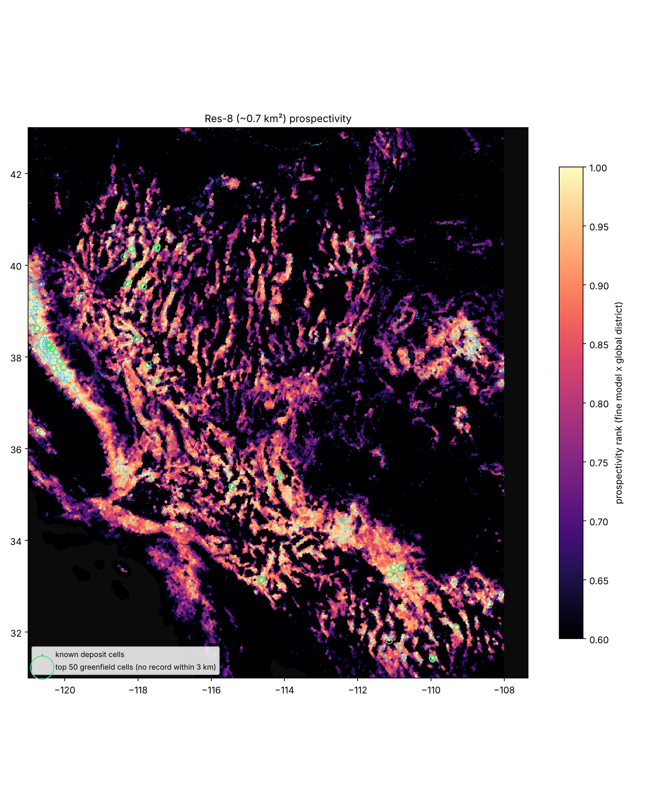

# v3: geoscience covariates, global labels, PU bagging, honest validation

v2 predicted prospectivity from AlphaEarth embeddings alone, trained on WRI/USGS
compilations with the US downweighted. v3 keeps the same grid (H3 res 6, 4.49M land
cells) and the AEF features, and changes almost everything around them.

Sources and licences are in [DATA_SOURCES.md](DATA_SOURCES.md). Results are in the
sections below, which `scripts/run_v3.py`, `ablate_v3.py` and `report_v3.py` regenerate.

## What changed and why

| | v2 | v3 | why |
|---|---|---|---|
| labels | WRI major deposits + mineral facilities + MRDS producers (~30k cells) | DARPA CriticalMAAS **MinMod** (MRDS + 30 USGS and state compilations, 414k sites), USGS minfac, **Global Copper Deposit Dataset**, **EarthByte porphyry** | many more non-US producers and typed deposits; MinMod compilation names fix the mineral system |
| label typing | 15 commodity classes | 15 commodities **and** 9 mineral systems (porphyry-skarn, epithermal-orogenic Au, VMS, sediment-hosted base metal, magmatic mafic, felsic-alkaline rare metal, chemical sedimentary, surficial, sandstone U) | a deposit model is closer to what geology controls than a commodity |
| features | AEF mean, std, 10/25 km context (256) | + gravity (EIGEN-6C4 disturbance, Bouguer, 200 km residual, HGM worms, vertical derivative, tilt), lithosphere (LITHO1.0 LAB, Moho, distance to the 170 km LAB edge; CRUST1.0 crust type), GEM active faults by kinematics, PB2002 plate boundaries, volcanoes, ESA WorldCover fractions, Copernicus DEM terrain, Sentinel-2 alteration ratios | AEF sees the surface; deposits are controlled by crustal architecture that only geophysics sees |
| model | feature NN with a non-negative PU loss | **PU-bagged LightGBM** (Mordelet & Vert 2014): each bag sees all positives against a fresh sample of unlabeled cells; NN kept as an option | trees handle mixed-scale covariates and missing values; bag spread is a free uncertainty estimate; TreeSHAP gives drivers |
| calibration | none (ranking) | prior-matched: the log-odds are shifted so mean presence over land equals an assumed deposit density | puts scores on a probability-like scale without pretending PU labels are complete |
| CV | H3 res-1 blocks | blocks **plus a 50 km dead zone** around each test block (Ploton et al. 2020), and an NNDM-style check that CV distances resemble prediction distances | adjacent cells in the same district leak |
| hold-outs | Africa, Australia, South America | same, plus targets that test leakage: occurrence-only cells, OpenStreetMap metal mines missing from every label set, positives without a mapped mine footprint, contained copper | a model that maps mine pits is not a prospectivity model |
| trust | none | **area of applicability** (Meyer & Pebesma 2021) and bag disagreement per cell | the model should say where it is extrapolating |
| explanation | AEF dimension correlations | TreeSHAP by feature family for the top 1%; family ablation under CV | which public dataset earns its place |

## Pipeline

```
python scripts/fetch_public_data.py                       # gravity, LITHO1.0, faults, plates, deposits ...
python -m earthprosp.minmod <ta2-minmod-data> data/minmod_sites.parquet
python scripts/fetch_global.py --year 2024 --out data/global_2024.npz      # AEF, ~34k COGs
python scripts/fetch_rasters.py worldcover --out data/worldcover_res6.parquet
python scripts/fetch_rasters.py dem --out data/dem_res6.parquet
python scripts/fetch_rasters.py s2 --out data/s2_res6.parquet
python scripts/prep_v3.py                                 # feature caches
python scripts/run_v3.py --out outputs/v3 --system-heads --cv-system-heads  # CV, hold-outs, final map
python scripts/ablate_v3.py --out outputs/v3              # family ablation
python scripts/report_v3.py --out outputs/v3              # maps, country table, greenfield list
python scripts/build_explorer_v3.py --out outputs/v3      # one-file HTML explorer
```

## Engineering notes

* **Network.** The canonical hosts for MRDS, NOAA, Zenodo and Source Cooperative were not
  reachable from the build machine. Every dataset is read from an S3 or GitHub mirror
  (`earthprosp/sources.py`), and AEF COGs through the bucket's S3 endpoint
  (`EARTHPROSP_AEF_HTTPS`).
* **Scale.** 4.49M cells x ~350 features is ~6 GB in float32 on a 15 GB machine. The
  PU bagger gathers only each bag's rows, the AEF shard merge streams, densities of
  faults and volcanoes come from smoothed rasters instead of radius queries, and the DI
  is computed in chunks.
* **Threads.** With OpenMP's default busy-waiting, a LightGBM fit on a shared 4-core
  machine ran 50x slower with 4 threads than with 1. `earthprosp/__init__.py` sets
  `OMP_WAIT_POLICY=PASSIVE`.
* **Data bugs found on the way.** 125 Global Copper Deposit Dataset rows sit at (0, 0);
  CRUST1.0's longitude index starts at -180, not 0; the fatiando gravity grid is total
  gravity, not a disturbance; "Iron and steel: iron ore" was double-counted by an
  " and " split.

## Results

Global run: 4,489,547 cells, 352 features (256 AEF + 96 covariates), 32,858 positive cells
(0.73% of land; 16,761 outside the US), 4,160 world-class cells. Capture AUC is the area
under the capture curve (0.5 = random, 1 = every positive ranked first). CV = mean over five
buffered block folds; hold-outs hide a whole continent from training.
`outputs/v3/cv_results.csv` has every split, target and capture@1/5/10/20%.

### Presence

| target | model | CV | Africa held out | Australia held out | S. America held out |
|---|---|---|---|---|---|
| all positives | distance to known deposits | 0.712 | 0.493 | 0.429 | 0.535 |
| | GBM, AEF only | 0.875 | 0.825 | 0.754 | **0.769** |
| | GBM, covariates only | 0.872 | 0.832 | **0.799** | 0.723 |
| | **GBM, AEF + covariates** | **0.888** | 0.852 | 0.794 | 0.747 |
| | + district smoothing | **0.892** | **0.855** | 0.791 | 0.747 |
| world-class | distance to known deposits | 0.640 | 0.433 | 0.435 | 0.541 |
| | GBM, AEF only | 0.825 | 0.847 | 0.786 | **0.752** |
| | **GBM, AEF + covariates** | **0.842** | **0.873** | **0.847** | 0.719 |
| contained Cu (GCDD tonnage) | GBM, AEF only | 0.907 | 0.954 | **0.940** | **0.814** |
| | **GBM, AEF + covariates** | **0.934** | **0.988** | 0.705 | 0.728 |

v2 for comparison (its own labels): world-class CV 0.805 (GBM), Africa 0.788, Australia
0.772, South America 0.688.

* **Geoscience helps, and helps most where AEF is weakest.** With Australia hidden,
  covariates alone (0.799) beat AEF alone (0.754): the Australian surface (deep weathering,
  regolith) hides the geology from a satellite, but gravity, magnetics and lithosphere see
  through it. On world-class deposits the joint model gains 6 points there and 2.6 in Africa.
* **South America is the exception.** AEF alone generalises best to a hidden South America
  (0.769 vs 0.747). The Andean arc is visible from space, and the covariates the model
  learned elsewhere (cratonic margins, LAB edge) point the wrong way for a young
  subduction margin. The dedicated porphyry head fixes most of this (below).
* **Contained copper** is dominated by a handful of giants, so single deposits swing it: in
  Australia, Olympic Dam alone is 71% of the GCDD tonnage, and the joint model ranks it lower
  than AEF alone does.
* **Leakage checks hold.** Positives in cells *without* a mapped mine footprint score the
  almost the same as all positives (CV 0.882 vs 0.888), and OpenStreetMap metal mines that are in no
  label set are found at 0.833 (0.785 for AEF alone): the covariates add signal that is not
  "this looks like a pit".
* **CV is conservative.** CV test cells sit a median 230 km from the nearest training
  positive; the map's cells sit a median 106 km away (`cv_distance_check.json`).

### Dedicated mineral-system models

One PU model per system, scored on held-out cells of that system, against the generic
presence model scored on the same cells (CV capture AUC):

| system | positive cells | generic presence | **system head** |
|---|---|---|---|
| epithermal / orogenic Au | 10,231 | 0.898 | **0.941** |
| porphyry / skarn Cu | 4,772 | 0.897 | **0.919** |
| VMS | 698 | 0.867 | **0.918** |
| sediment-hosted base metal | 4,613 | 0.893 | **0.916** |
| sandstone / unconformity U | 1,100 | 0.814 | **0.903** |
| chemical sedimentary (BIF, Mn, P) | 5,909 | 0.873 | **0.899** |
| magmatic mafic (Ni-Cu-PGE-Cr) | 1,695 | 0.874 | **0.896** |
| surficial (laterite, placer) | 598 | 0.863 | **0.871** |
| felsic / alkaline rare metal | 2,525 | 0.859 | **0.867** |

The system head wins in CV for all nine. Across continents it is mixed: porphyry in a
hidden South America jumps from 0.744 to **0.937**, and magmatic mafic in a hidden Australia
from 0.699 to 0.871, but sandstone U in Australia collapses (0.900 to 0.252; there are few
training examples and Australian unconformity U looks nothing like the Colorado Plateau).
The map carries both: `p_prospective` (generic) and `head_<system>` ranks.

### Towns: a confound, and how the map removes it

The first global v3 map had a town problem. Cells more than 20% built-up (ESA WorldCover)
are 0.7% of land and 2.6% of known-deposit cells, but they were **12.3%** of the map's
top 1% (14% of its unlabelled top 1%), and WorldCover built-up fraction was the third most
important feature. Mines make towns, so a PU model learns "town" as a deposit cue, and
then ranks Qingdao, Tijuana, Daegu and Las Vegas next to Lubumbashi.

| run | what it does | CV | Africa | Australia | S. America | urban share of top 1% |
|---|---|---|---|---|---|---|
| v3 | built-up and cropland fractions as ordinary features | 0.888 | 0.852 | 0.794 | 0.747 | 12.3% |
| v3b | drop built-up and cropland | 0.888 | 0.847 | 0.802 | 0.731 | 9.6% |
| **v3n** | **keep them in training, set them to 0 when predicting** | **0.888** | 0.841 | 0.782 | 0.744 | **1.4%** |

(capture AUC, all positives, GBM on AEF + covariates; the urban share of land is 0.7%.)

Dropping the columns barely helps: the AlphaEarth embedding sees towns too, and the trees
take the town signal from there instead. Keeping the land-cover columns in training gives
the model an explicit place to put it, and predicting with them held at zero asks "how
prospective would this cell look with no town or farmland on it". CV skill is unchanged,
hold-outs move by about a point either way, and towns in the top 1% fall to about twice
their share of land, which matches their share of known deposits
(`--neutralize-features wc_built,wc_crop`; `urban_diagnostic.json` in each output folder).

### Subduction geometry, seismicity and geologic provinces: a negative result

The weakest test is a hidden South America, and the Andean porphyry belt sits where the
subducting slab is about 100 km deep. Plate-boundary distance alone cannot place that
line, because it depends on slab dip, so v3c added 19 features from three more public
datasets: Slab2 slab-top depth (27 zones), ~199k ISC-GEM and USGS ComCat hypocentres, and
the USGS world geologic provinces (`seis_*`, `slab_*`, `prov_*`; see DATA_SOURCES.md).

| capture AUC | without (v3n) | with (v3c) |
|---|---|---|
| all deposits, CV / Africa / Australia / S. America | 0.888 / 0.841 / 0.782 / **0.744** | 0.888 / 0.842 / **0.792** / 0.739 |
| world-class, CV / S. America | 0.837 / **0.713** | **0.841** / 0.699 |
| porphyry head, CV / S. America | 0.918 / **0.939** | 0.919 / 0.929 |
| epithermal-orogenic Au head, CV / S. America | 0.940 / 0.781 | 0.941 / **0.796** |

Nothing moves by more than about a point, in either direction. The trees do use the new
features (shield fraction ranks 12th by gain), but the information was already there:
AlphaEarth sees the arc's volcanic landscape, and the existing distance-to-subduction,
volcano and LAB features already place it. The shipped map is v3n, without them; the
features stay in the pipeline (`outputs/v3c`, `outputs/sys_base`, `outputs/sys_slab`).

### Which datasets earn their place

Family ablation under three buffered CV folds (`outputs/ablation/ablation.csv`; two bags
per model, so differences under ~0.003 are noise):

| | all deposits | outside the US | world-class |
|---|---|---|---|
| AEF only | 0.885 | 0.842 | 0.822 |
| everything | **0.891** | **0.858** | **0.836** |
| best single addition to AEF | litho +0.006 | province +0.007 | province +0.008 |
| largest loss when one family is removed | heat flow −0.002 | land cover −0.005 | province −0.006 |

Inside the training continents, no single dataset matters much: AlphaEarth already
carries most of what the trees can use, and the geoscience families are largely
redundant with each other (removing any one costs at most half a point). Together they
add 1.6 points outside the US and 1.4 on world-class deposits, and their real value shows
when a whole continent is hidden (Australia: covariates alone 0.799 vs AEF alone 0.754).
A grouped ablation on the hold-outs (`ablate_v3.py --holdouts --groups`) measures that
directly.

### Survey-effort background: a negative result

The US still holds 25% of the map's top 5% (6.3% of land). Target-group background
sampling (`--target-group`: draw unlabelled cells in proportion to regional density of
*any* mineral record, so negatives come from places people looked) is the textbook fix
for presence-only survey bias. Here it overcorrects badly: the model learns "explored
means barren", the US share of the top 5% falls to 0.2%, CV capture AUC falls from 0.888
to 0.594, every hold-out loses 1–2 points, and the area of applicability shrinks from 94%
to 73% of land (`outputs/tg`). Label-propensity weighting (already in v3) stays the bias
control; the remaining US share is partly real (the western US is one of the best-endowed
regions on Earth) and partly labels, and the country table should be read with that in mind.

#### On the hold-outs, only the lithosphere transfers

The same ablation with whole continents hidden, by family group (`outputs/ablation_holdout`;
capture AUC, all deposits / world-class; two bags per model):

| | Africa | Australia | S. America |
|---|---|---|---|
| AEF only | 0.823 / 0.844 | 0.746 / 0.771 | **0.773 / 0.756** |
| + lithosphere (LITHO1.0, CRUST1.0, heat flow) | 0.835 / 0.856 | **0.783 / 0.833** | 0.757 / 0.747 |
| + surface (land cover, terrain, Sentinel-2) | 0.827 / 0.846 | 0.776 / 0.806 | 0.768 / 0.750 |
| + geophysics (gravity, magnetics, topography) | 0.817 / 0.837 | 0.747 / 0.772 | 0.728 / 0.707 |
| + tectonics (faults, plates, volcanoes, seismicity, slabs, provinces) | 0.832 / 0.848 | 0.768 / 0.763 | 0.705 / 0.693 |
| everything | **0.838 / 0.858** | 0.787 / 0.826 | 0.736 / 0.691 |

Lithospheric architecture (depth to the LAB, craton edges, crust type, heat flow) is the
one geoscience signal that carries from one continent to another: it adds 3.7 points on a
hidden Australia and 6 on its world-class deposits. Gravity, magnetics and the tectonic
layers help inside the training continents but hurt a hidden South America by 4–7 points:
the trees learn region-specific relationships (a Bouguer low means one thing in the
Basin and Range and another in the Andes) that do not transfer. AEF alone remains the
best single predictor for a hidden South America.

### The shipped map: lean (v3L)

Following the hold-out ablation, v3L keeps AlphaEarth, the lithosphere group (LITHO1.0,
CRUST1.0 crust type, heat flow) and the surface group (land cover with towns neutralised,
Copernicus DEM terrain, Sentinel-2 alteration), and drops gravity, magnetics, regional
topography, faults, plates, volcanoes, seismicity, slabs and provinces (302 features).

| capture AUC | v3n (all covariates) | **v3L (lean)** |
|---|---|---|
| CV, all / world-class | 0.888 / 0.837 | 0.888 / 0.839 |
| Africa hidden, all / world-class | 0.841 / 0.860 | 0.838 / 0.861 |
| Australia hidden, all / world-class | 0.782 / 0.844 | **0.802** / 0.841 |
| S. America hidden, all / world-class | 0.744 / 0.713 | **0.774 / 0.755** |
| contained Cu, Australia / S. America hidden | 0.702 / 0.713 | **0.793 / 0.805** |
| OSM metal mines not in any label set, CV / Australia | 0.832 / 0.818 | 0.835 / **0.862** |
| porphyry head, CV / S. America hidden | 0.918 / 0.939 | 0.911 / 0.915 |
| epithermal-orogenic Au head, CV / Australia hidden | 0.940 / 0.827 | 0.939 / **0.862** |

CV is unchanged, and every continent-scale transfer test except the porphyry head in
South America improves, several by 3–9 points. Towns stay at 1.4% of the top 1%, and the
top 1% is still not enriched in 2018–2024 surface change (5.4% in the top 5% of change).
Fewer, more transferable inputs beat more inputs: a model trained on four continents is
more useful on the fifth when it leans on what is physically comparable everywhere (the
satellite view and the lithosphere).

## v4 experiments: what did not move the needle (and why the v3L map stands)

All runs below hide one region at a time and score it (`scripts/transfer_v4.py`). South
America, Australia and Africa were the v3 hold-outs; **Canada north of 50°N and Central
Asia were added as untouched checks**, so a setting tuned to the first three has to hold
up on two regions no earlier decision looked at. Differences carry 90% block-bootstrap
intervals (H3 res-2 blocks, `scripts/bootstrap_transfer.py`,
`outputs/transfer/bootstrap_vs_lean.csv`).

| capture AUC, all deposits | S. America | Australia | Africa | Canada | Central Asia |
|---|---|---|---|---|---|
| **v3L lean (shipped)** | 0.775 | 0.802 | 0.838 | **0.824** | 0.714 |
| shallow trees (15 leaves, ≥200 per leaf) | +1.5 | +0.7 | −0.5 | **−3.1** | +0.4 |
| shallow + extremely randomised splits | +1.3 | +1.5 | −0.3 | **−3.6** | +1.5 |
| strong regularisation | +0.8 | +0.1 | −0.6 | −1.5 | +0.2 |
| rank blend of lean and shallow+random | +1.0 | +1.1 | +0.1 | −1.3 | +1.0 |
| rank blend of lean and AEF-only | +0.8 | −1.3 | −0.1 | −0.6 | −0.6 |
| AEF only | −0.5 | −4.8 | −1.3 | −2.8 | −2.3 |
| 2018 + 2024 AlphaEarth averaged (lean) | +0.1 | −1.9 | 0.0 | +0.1 | +1.0 |

(points of capture AUC relative to v3L; most single differences under ~1 point are inside
their 90% interval.)

* **Tree depth trades regions against each other.** Shallower, more random trees help
  where the hidden region is geologically far from the training data (Andes, Australian
  cratons, Central Asian orogens) and cost Canada 3–4 points, where deep interactions
  learned on the US and Alaska carry over. The blend splits the difference (+0.4 points
  averaged over five regions, world-class deposits never significantly worse). That is
  too small and too region-dependent to justify a second model in the map, so v3L keeps
  the default trees.
* **AlphaEarth alone never wins**, and blending it back in only helps South America.
* **Averaging two AlphaEarth years does not help.** At 36 km² per cell the annual noise
  is already averaged out; the embedding's year-to-year variation is not what limits
  transfer.

## v4: a 0.7 km² grid finds deposits better than the 36 km² map

The global map works on H3 res-6 cells (~36 km²) built from 1,280 m AlphaEarth overview
pixels. `scripts/fetch_global.py --level 3 --res 8 --bbox ...` reads the 160 m overview
instead (~32 pixels per res-8 cell of ~0.7 km²), and `scripts/downscale.py` compares, in
the same region and the same spatial block folds (H3 res-2 blocks, 10 km dead zone):

* **coarse:** a res-6 model (AEF aggregated from the res-8 cells, ring context, the lean
  covariates, res-6 labels), its score copied to every res-8 child;
* **fine:** a res-8 model (own AEF mean/std, rings of ~2 and ~5 km, the parent's AEF and
  covariates, res-8 labels).

Both are scored on res-8 cells. "Inside districts" ranks only the res-8 cells inside the
coarse model's top 10% of res-6 cells: once a district is chosen, which square kilometre?

| capture AUC (mean of 5 folds) | Great Basin + Arizona | Central Andes (Peru, Chile, Bolivia, NW Argentina) |
|---|---|---|
| res-8 cells / positive cells | 1.76M / 16,902 | 2.11M / 4,950 |
| coarse: all deposits / inside districts | 0.788 / 0.625 | 0.819 / 0.648 |
| **fine: all deposits / inside districts** | **0.822 / 0.699** | **0.831 / 0.689** |
| fine, deposits with no mine or quarry within ~1.5 km | 0.818 / 0.700 | 0.823 / 0.681 |
| fine top 5% of area captures | 34% of deposit cells (coarse 28%) | 40% (coarse 37%) |

The fine model wins in all ten folds across both regions, and by more inside districts
(+4 to +7 points) than overall: the extra resolution is most useful for narrowing a known
belt down to targets. It is not just seeing pits: the gain holds for deposits with no
mapped mine or quarry nearby, and for prospects with no recorded production in the
Great Basin (0.789 vs 0.759).

Maps and target lists (`outputs/downscale_wus`, `outputs/downscale_andes`):
`map_res8.png` (fine score × global district score, ranked), and
`greenfield_targets_res8.csv`, the 50 highest cells with no mineral record of any kind
within ~3 km, one per ~5 km. In the Andes they fall in the Coquimbo region of Chile
(30–32°S) and near the Bolivian altiplano copper belt (17°S); in the US, in the Mother
Lode gold belt, around Globe–Miami and in northern Nevada.



## v5: fifteen belts at 0.7 km², and one model trained on all of them

`scripts/belts.sh` runs the v4 test (fetch the 160 m AEF overview, `downscale.py --final`)
on 13 more metallogenic belts, for 15 in all and 28.1 million res-8 cells. Every belt gets
a map, 50 greenfield targets and the same 5-fold fine vs coarse test. All of it is in one
page, `outputs/atlas/index.html` (`scripts/build_belt_atlas.py`).

**Does the fine grid win everywhere?** No, but in most belts it does. It ranks
held-out deposits better in 10 of 15 belts (median capture AUC 0.822 vs 0.799), and in 11
of 15 inside the top-10% districts (median 0.694 vs 0.648). The biggest gains are in
Abitibi (+0.057 overall, +0.11 inside districts), Fennoscandia and the Great Basin. It loses
in the Copperbelt, Mexico, Papua New Guinea, Tibet and, narrowly, the Northern Andes.
Tibet and PNG have only 50 deposit cells each. In the Copperbelt the deposits sit in one
stratigraphic package that a 36 km² cell captures well.

**One model for all belts** (`scripts/pool_belts.py`). `downscale.py` also writes a
training sample per belt to `data/pool/`: every cell with a record, plus a uniform 4% of
all cells. Within each belt's 5 spatial folds, three res-8 models score the same held-out
cells:

* local: the belt's own training folds;
* pooled: the other 14 belts plus the belt's own training folds;
* never seen: the other 14 belts only (leave one belt out).

Scores are estimated against the uniform cells, so "local" differs slightly from "fine" above.

| belt | deposit cells | coarse | fine | inside districts, coarse / fine | pooled | never seen |
|---|---|---|---|---|---|---|
| Great Basin and Arizona | 16,902 | 0.788 | **0.822** | 0.625 / 0.699 | 0.792 (local 0.823) | 0.727 |
| Central Andes | 4,950 | 0.819 | **0.831** | 0.648 / 0.689 | 0.837 (local 0.831) | 0.714 |
| Northern Andes | 1,316 | **0.855** | 0.849 | 0.570 / 0.589 | 0.857 (local 0.855) | 0.778 |
| Yilgarn and Pilbara | 334 | 0.893 | **0.894** | 0.788 / 0.821 | 0.878 (local 0.893) | 0.790 |
| Abitibi and Superior | 938 | 0.784 | **0.841** | 0.715 / 0.828 | 0.852 (local 0.843) | 0.807 |
| Central African Copperbelt | 182 | **0.837** | 0.762 | 0.859 / 0.675 | 0.915 (local 0.703) | 0.885 |
| Southern Africa | 506 | 0.830 | **0.838** | 0.657 / 0.694 | 0.827 (local 0.852) | 0.795 |
| Iranian Tethyan belt | 458 | 0.812 | **0.827** | 0.581 / 0.623 | 0.812 (local 0.821) | 0.791 |
| Tibet and Yulong | 50 | **0.693** | 0.675 | 0.572 / 0.709 | 0.693 (local 0.666) | 0.547 |
| Kazakhstan and Tien Shan | 497 | 0.812 | **0.828** | 0.685 / 0.736 | 0.819 (local 0.828) | 0.751 |
| Sierra Madre, Mexico | 893 | **0.762** | 0.722 | 0.597 / 0.531 | 0.726 (local 0.746) | 0.639 |
| British Columbia and SE Alaska | 563 | 0.751 | **0.764** | 0.445 / 0.568 | 0.771 (local 0.766) | 0.734 |
| Fennoscandian Shield | 289 | 0.649 | **0.678** | 0.672 / 0.818 | 0.710 (local 0.697) | 0.732 |
| Carajás and Quadrilátero Ferrífero | 375 | 0.799 | **0.800** | 0.808 / 0.780 | 0.816 (local 0.804) | 0.731 |
| Papua New Guinea | 50 | **0.763** | 0.733 | 0.595 / 0.520 | 0.763 (local 0.733) | 0.755 |

* **Pooling helps where a belt has little data.** It beats local in 9 of 15 belts. Five of
  the six belts with fewer than 400 deposit cells gain, led by the Copperbelt (0.703 to
  0.915), PNG, Tibet and Fennoscandia. Data-rich belts (the Great Basin, southern Africa,
  Mexico) do slightly better on their own. The gain correlates with fewer deposit cells
  (Spearman -0.62). Overall, the median capture AUC is 0.816 pooled vs 0.821 local, but
  the top 5% of ground holds 36.5% of deposits pooled vs 34.3% local.
* **A belt the model has never seen still works.** The median capture AUC is 0.751, and
  0.885 in the Copperbelt. This is the number that matters for frontier ground with no
  deposits on record. It is lowest in Tibet (0.547) and Mexico (0.640), whose deposit
  styles are least like the other belts.
* The rank blend of local and never-seen does not help (median 0.794).

Practical rule: map a belt with its own model when it has more than a few hundred deposit
cells, otherwise with the pooled one.

### Frontier regions: does the pooled model carry the map where records are thin?

`pool_belts.py --fit-final data/pooled_res8.joblib` fits one res-8 model on all 15 belts.
`scripts/frontier.sh` maps four under-explored shields with it (`downscale.py --pooled-model`).
In each, the same 5-fold test scores the region's own fine and coarse models alongside the
pooled model. The pooled model has never seen any of these regions, and it is scored on every
held-out cell, not on a sample.

| region | deposit cells | coarse | fine (local) | pooled (unseen) | inside districts: coarse / fine / pooled | mapped with |
|---|---|---|---|---|---|---|
| West African Birimian | 125 | 0.718 | **0.772** | 0.689 | 0.642 / 0.685 / 0.571 | fine |
| Arabian-Nubian Shield | 99 | **0.777** | 0.749 | 0.692 | 0.605 / 0.562 / 0.612 | fine |
| Guiana Shield | 458 | 0.841 | **0.843** | 0.724 | 0.641 / 0.651 / 0.724 | fine |
| Gobi and South Mongolia | 42 | 0.829 | 0.804 | **0.848** | 0.566 / 0.704 / 0.748 | pooled |

* **A hundred local deposits beat 15 belts of someone else's.** The pooled model alone wins
  only in the Gobi, which has 42 deposit cells. Its unseen-region scores (0.69 to 0.85) match
  the leave-one-belt-out estimate (median 0.75). That is useful where nothing is recorded, but
  it is not better than a local model trained on even ~100 deposits.
* **It does better at the final step.** Inside the top districts the pooled model is best in
  three of the four regions (Arabian-Nubian, Guiana and Gobi).
* Pooled-plus-local training, which won in 5 of 6 data-poor belts above, needs each region's
  own folds in the pool. It was not run here.

So the map model is now chosen by evidence. When a CV has run, `final_map` uses whichever of
fine and pooled won it. Without a CV, it uses pooled below `--pool-below` positive cells.
Birimian and Arabian-Nubian were first mapped with pooled under the size rule, then re-mapped
with fine once the CV was in.

**Pooled plus local on the frontier** (`pool_belts.py --only birimian,arabian_nubian,guiana,gobi`,
sample-based scores as in the 15-belt table):

| region | local | pooled + local | pooled only (unseen) |
|---|---|---|---|
| West African Birimian | **0.770** | 0.763 | 0.717 |
| Arabian-Nubian Shield | **0.771** | 0.739 | 0.697 |
| Guiana Shield | 0.856 | **0.858** | 0.724 |
| Gobi and South Mongolia | 0.826 | **0.843** | 0.835 |

Adding the 15 belts to a region's own deposits is a wash here: the median is 0.803 vs 0.798,
with two wins and two losses. The top 1% of ground holds more deposits (14% vs 10%). The
frontier regions have 42 to 458 deposit cells. With that much local data, other belts add
little; they matter for the ranking at the very top and in the Gobi.

### Is the res-8 model the right size?

`scripts/capacity_res8.py` reruns the local model on every region's pool sample, with the same
folds and scoring as `pool_belts.py`. Two variants change the background sampling and the bag count.
Four change the trees. Results are in `outputs/capacity_res8*`.

* **Smaller trees help where deposits are few.** 15 leaves (vs 63) and at least 20 rows per
  leaf beat the default in 12 of 17 regions. The median gain is small (+0.002), but the
  Copperbelt goes from 0.70 to 0.84. With 182 deposit cells, the default trees cannot fit it.
* More bags alone (16 vs 4) do nothing: the Copperbelt stays at 0.70. Bigger trees (800 x 127
  leaves) and 20x more background per bag do not help either.
* **Copperbelt, full test** (`downscale.py --fine-params '{"num_leaves": 15, "min_child_samples": 20}'
  --fine-bags 16`). The 0.7 km² model goes from 0.762 to 0.832 overall, against 0.837 for 36 km².
  Inside districts it goes from 0.675 to 0.879, against 0.859. Its top 5% of ground holds 56% of
  deposits, against 49%. The blend scores 0.850, the best of the three. The Copperbelt map now uses
  these settings. The old run is kept as `downscale_*_63leaves.csv`.

### Finer still? Raster features at 0.7 km², and 0.1 km² cells

* **Sentinel-2 alteration and terrain at res 8** (`fetch_rasters.py --res 8 --bbox`,
  `downscale.py --extra-res8`) were tested in the Great Basin. The 0.7 km² model scores 0.822 with
  or without the clay, ferric, ferrous and gossan ratios, and 0.822 with terrain added too. The
  AlphaEarth embedding already carries what these band ratios measure.
* **0.1 km² (res 9) around the Carlin trend** (-118 to -114°E, 39 to 42°N). This uses 80 m AlphaEarth,
  1.55M cells and `--block-res 3`. On its own labels the res-9 model scores 0.788, against 0.769 for
  res 8 on res-8 labels, and it beats the coarse model by +0.070 vs +0.054. On the same res-8
  labels, though (res-9 scores maxed over each res-8 cell), it ties: 0.773 vs 0.775. So the finer
  grid places a deposit within its 0.7 km² cell. It does not choose better among 0.7 km² cells.
  Res 8 stays the working resolution.
